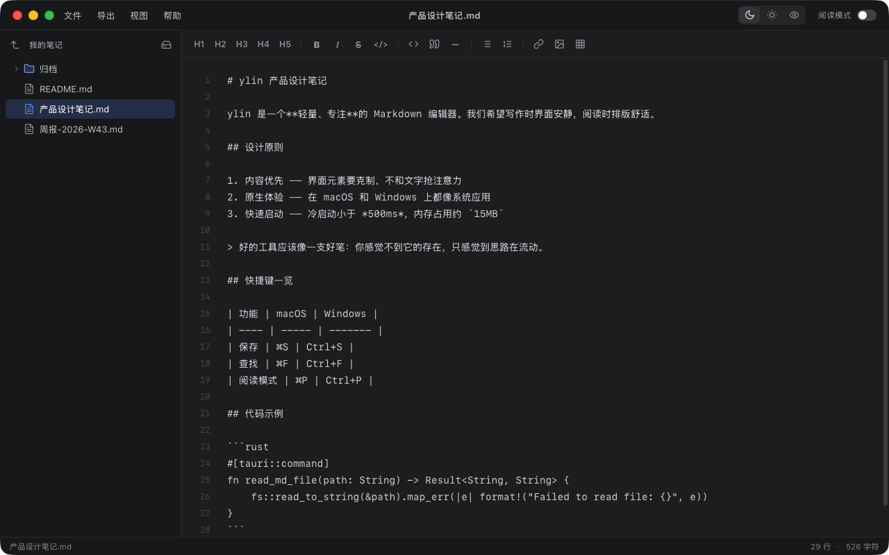
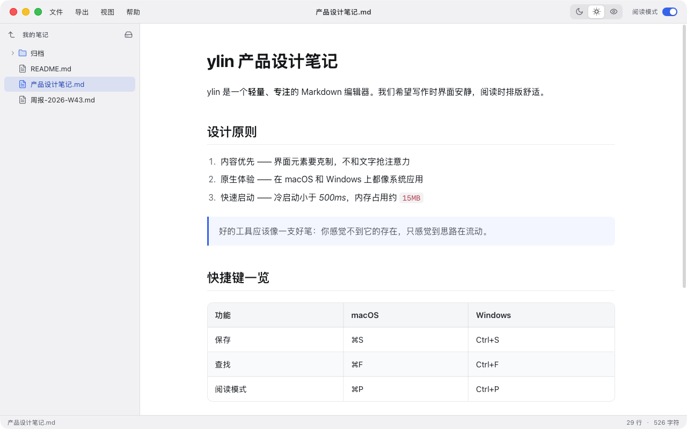

<div align="center">


# ylin

**A fast, lightweight Markdown editor built with Tauri 2 + Rust**

[English](#english) | [中文](#中文)

[](https://github.com/Fuswn/ylin/releases)
[](https://github.com/Fuswn/ylin/releases)
[](LICENSE)
[](https://v2.tauri.app)
[](https://www.rust-lang.org)

</div>

---

<a id="english"></a>

## Features

- **Edit & Read** — Switch between the Markdown source and a typeset reading view in one keystroke
- **Three Themes** — Dark, Light and Sepia (eye-care); the native window chrome follows the theme
- **Native Feel** — Unified title bar and ⌘ shortcuts on macOS, native dialogs on both platforms
- **File Tree** — Lazy-loading sidebar for folders and `.md` files, with the open file highlighted
- **Find** — Search the source while editing or the rendered text while reading
- **Syntax Highlighting** — Code blocks rendered with highlight.js
- **Markdown Toolbar** — Headings, bold, italic, code, lists, links, images, tables
- **Export** — HTML or PDF, with the same typography as the reading view
- **Open Anywhere** — "Open With" from Explorer / Finder, or drag & drop `.md` files onto the window
- **Native Performance** — Rust backend with a tiny memory footprint (~15MB)
- **Cross-platform** — Windows (NSIS installer) and macOS (`.app` / `.dmg`)

## Screenshots

<p align="center">
  
  <br /><br />
  
</p>

## Installation

### Download

Download the latest release from the [Releases](https://github.com/Fuswn/ylin/releases) page: `*_x64-setup.exe` for Windows, `*_aarch64.dmg` for macOS.

> **macOS:** the app is not notarized by Apple. If macOS blocks it on first launch, open **System Settings → Privacy & Security** and click **Open Anyway**.

### Build from Source

**Prerequisites:** [Node.js](https://nodejs.org/) (v18+), [Rust](https://www.rust-lang.org/tools/install) (v1.77.2+), platform-specific [Tauri dependencies](https://v2.tauri.app/start/prerequisites/)

```bash
# Clone the repository
git clone https://github.com/Fuswn/ylin.git
cd ylin

# Install dependencies
npm install

# Run in development mode
npm run dev

# Build for production
npm run build
```

Build output:

- **Windows** — installer in `src-tauri/target/release/bundle/nsis/`, executable at `src-tauri/target/release/ylin.exe`
- **macOS** — `src-tauri/target/release/bundle/macos/ylin.app`, disk image in `src-tauri/target/release/bundle/dmg/`

## Keyboard Shortcuts

| Shortcut | Action |
|----------|--------|
| `Ctrl+N` | New file |
| `Ctrl+O` | Open file |
| `Ctrl+Shift+O` | Open folder |
| `Ctrl+S` | Save |
| `Ctrl+Shift+S` | Save as |
| `Ctrl+B` | Toggle sidebar / Bold (in editor) |
| `Ctrl+I` | Italic (in editor) |
| `Ctrl+K` | Insert link (in editor) |
| `Ctrl+P` | Toggle reading mode |
| `Ctrl+F` | Find |
| `F3` / `Shift+F3` | Find next / previous |
| `Tab` | Insert 4 spaces (in editor) |

On macOS, use `⌘` instead of `Ctrl` (e.g. `⌘S`, `⇧⌘O`); find next / previous is also `⌘G` / `⇧⌘G`.

## Tech Stack

| Layer | Technology |
|-------|-----------|
| Framework | [Tauri 2](https://v2.tauri.app) |
| Backend | Rust, [rfd](https://github.com/PolyMeilex/rfd) (native dialogs), [tauri-plugin-opener](https://v2.tauri.app/plugin/opener/) (open links) |
| Frontend | Vanilla JavaScript (no framework, no bundler) |
| Markdown | [markdown-it](https://github.com/markdown-it/markdown-it) |
| Syntax Highlighting | [highlight.js](https://highlightjs.org/) |
| App Icon | Wordmark set in [Nunito](https://fonts.google.com/specimen/Nunito) (SIL Open Font License 1.1) |

## Project Structure

```
ylin/
├── src/                  # Frontend (served as static files)
│   ├── index.html
│   ├── assets/           # Logo shown in the About dialog
│   ├── js/               # App modules (app, editor, preview, file-tree, themes, toolbar)
│   ├── lib/              # Vendored libs (markdown-it, highlight.js)
│   └── styles/           # CSS (themes, editor, preview, toolbar, etc.)
├── src-tauri/            # Rust backend
│   ├── src/              # Tauri commands & file operations
│   ├── icons/            # App icons (generated); source/ holds the SVG masters + build script
│   ├── tauri.conf.json   # Tauri configuration
│   ├── tauri.macos.conf.json  # macOS overrides (title bar, .app/.dmg, .md file association)
│   └── Cargo.toml
├── docs/                 # Screenshots
└── package.json
```

## Contributing

Contributions are welcome! Feel free to open an [Issue](https://github.com/Fuswn/ylin/issues) or submit a [Pull Request](https://github.com/Fuswn/ylin/pulls).

1. Fork this repository
2. Create your feature branch (`git checkout -b feature/amazing-feature`)
3. Commit your changes (`git commit -m 'Add amazing feature'`)
4. Push to the branch (`git push origin feature/amazing-feature`)
5. Open a Pull Request

## License

This project is licensed under the [MIT License](LICENSE).

---

<a id="中文"></a>

<div align="center">

# ylin

**基于 Tauri 2 + Rust 构建的快速、轻量级 Markdown 编辑器**

</div>

## 功能特性

- **编辑 / 阅读** — 一键在 Markdown 源码和排版精美的阅读视图之间切换
- **三种主题** — 深色、浅色、护眼（Sepia），系统窗口外观随主题切换
- **原生体验** — macOS 上采用一体化标题栏和 ⌘ 快捷键，两个平台都使用系统原生对话框
- **文件树** — 侧边栏懒加载，浏览文件夹和 `.md` 文件，高亮当前打开的文件
- **查找** — 编辑时搜索源码，阅读时搜索渲染后的文字
- **语法高亮** — 代码块使用 highlight.js 渲染
- **Markdown 工具栏** — 标题、粗体、斜体、代码、列表、链接、图片、表格
- **导出功能** — 导出为 HTML 或 PDF，排版与阅读视图一致
- **随处打开** — 在资源管理器 / 访达中用"打开方式"打开，或把 `.md` 文件拖进窗口
- **原生性能** — Rust 后端，极小内存占用（约 15MB）
- **跨平台** — 支持 Windows（NSIS 安装包）和 macOS（`.app` / `.dmg`）

## 截图

<p align="center">
  
  <br /><br />
  
</p>

## 安装

### 下载

从 [Releases](https://github.com/Fuswn/ylin/releases) 页面下载最新版本：Windows 下载 `*_x64-setup.exe`，macOS 下载 `*_aarch64.dmg`。

> **macOS：** 应用未经过 Apple 公证。首次打开如被系统拦截，请前往「系统设置 → 隐私与安全性」，点击「仍要打开」。

### 从源码构建

**前置要求：** [Node.js](https://nodejs.org/)（v18+）、[Rust](https://www.rust-lang.org/tools/install)（v1.77.2+）、对应平台的 [Tauri 依赖](https://v2.tauri.app/start/prerequisites/)

```bash
# 克隆仓库
git clone https://github.com/Fuswn/ylin.git
cd ylin

# 安装依赖
npm install

# 开发模式运行
npm run dev

# 生产构建
npm run build
```

构建产物：

- **Windows** — 安装包位于 `src-tauri/target/release/bundle/nsis/`，可执行文件为 `src-tauri/target/release/ylin.exe`
- **macOS** — `src-tauri/target/release/bundle/macos/ylin.app`，磁盘映像位于 `src-tauri/target/release/bundle/dmg/`

## 快捷键

| 快捷键 | 功能 |
|--------|------|
| `Ctrl+N` | 新建文件 |
| `Ctrl+O` | 打开文件 |
| `Ctrl+Shift+O` | 打开文件夹 |
| `Ctrl+S` | 保存 |
| `Ctrl+Shift+S` | 另存为 |
| `Ctrl+B` | 切换侧边栏 / 粗体（编辑器内） |
| `Ctrl+I` | 斜体（编辑器内） |
| `Ctrl+K` | 插入链接（编辑器内） |
| `Ctrl+P` | 切换阅读模式 |
| `Ctrl+F` | 查找 |
| `F3` / `Shift+F3` | 查找下一个 / 上一个 |
| `Tab` | 插入 4 个空格（编辑器内） |

macOS 上用 `⌘` 代替 `Ctrl`（如 `⌘S`、`⇧⌘O`），查找下一个 / 上一个也可以用 `⌘G` / `⇧⌘G`。

## 技术栈

| 层级 | 技术 |
|------|------|
| 框架 | [Tauri 2](https://v2.tauri.app) |
| 后端 | Rust、[rfd](https://github.com/PolyMeilex/rfd)（原生对话框）、[tauri-plugin-opener](https://v2.tauri.app/plugin/opener/)（打开链接） |
| 前端 | 原生 JavaScript（无框架、无打包工具） |
| Markdown 解析 | [markdown-it](https://github.com/markdown-it/markdown-it) |
| 语法高亮 | [highlight.js](https://highlightjs.org/) |
| 应用图标 | 字标使用 [Nunito](https://fonts.google.com/specimen/Nunito) 字体（SIL Open Font License 1.1） |

## 项目结构

```
ylin/
├── src/                  # 前端（直接作为静态文件提供）
│   ├── index.html
│   ├── assets/           # 关于面板中的 Logo
│   ├── js/               # 应用模块（app、editor、preview、file-tree、themes、toolbar）
│   ├── lib/              # 第三方库（markdown-it、highlight.js）
│   └── styles/           # 样式（主题、编辑器、预览、工具栏等）
├── src-tauri/            # Rust 后端
│   ├── src/              # Tauri 命令与文件操作
│   ├── icons/            # 应用图标（生成产物）；source/ 下是 SVG 源文件和生成脚本
│   ├── tauri.conf.json   # Tauri 配置
│   ├── tauri.macos.conf.json  # macOS 专属配置（标题栏、.app/.dmg、.md 文件关联）
│   └── Cargo.toml
├── docs/                 # 截图
└── package.json
```

## 贡献

欢迎贡献！请随时提交 [Issue](https://github.com/Fuswn/ylin/issues) 或 [Pull Request](https://github.com/Fuswn/ylin/pulls)。

1. Fork 本仓库
2. 创建特性分支（`git checkout -b feature/amazing-feature`）
3. 提交更改（`git commit -m 'Add amazing feature'`）
4. 推送到分支（`git push origin feature/amazing-feature`）
5. 发起 Pull Request

## 许可证

本项目基于 [MIT 许可证](LICENSE) 开源。
